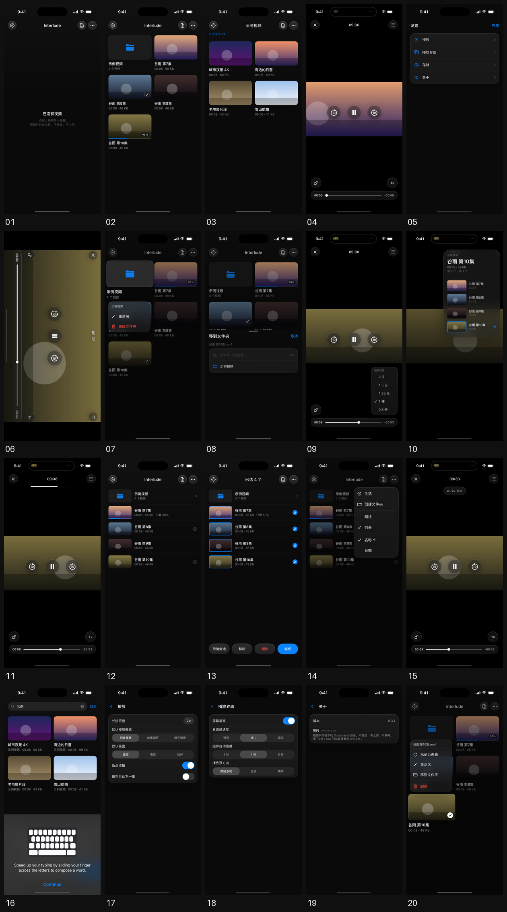

# 幕间 · Interlude

<p align="center">
  
</p>


**iOS 本地视频播放器。** 离线播放，无账号，不联网。

29 个 Swift 文件，不到 7000 行，SwiftUI + AVPlayer，零依赖。

## 为什么

**不联网**　全仓库没有 `URLSession`，也没有 `WKWebView`；`Info.plist` 里没有 ATS 例外。播放器不需要服务器。

**不留痕**　没有账号、埋点与第三方 SDK，依赖清单是空的。从相册导入走系统选择器，App 只拿到你选中的那几个文件。

**文件归你**　视频保存在 App 的「幕间」文件夹，不改名、不转码、不上传。卸载 App，文件随之删除。

## 使用

**导入**　三条路：在「文件」App 里拷进「幕间」、从导入菜单选相册、连数据线在访达里拖进文件区。批量导入有进度，结束时报成功与重名的数量。

**播放**　点卡片即播，从上次离开的位置继续。控件静止片刻自动隐去，轻点屏幕唤回。

| 操作 | 结果 |
|---|---|
| 横滑 | 拖进度，画面跟着手指走，松手前预览目标帧 |
| 左半屏上下滑 | 亮度 |
| 右半屏上下滑 | 音量 |
| 右半屏长按 | 临时加速 1.5–3×，松手复原 |
| 双击左 / 右 | 后退 / 前进 10 秒 |
| 双指捏合 | 切换画面比例 |
| 单击 | 唤回控件；锁定时看时间与进度 |

左半屏不设长按。整片留给亮度，调光时不会误触加速。

**连看**　打开「播完自动下一集」，同一文件夹内顺序推进；列表循环、单集循环、播完暂停三档，播完自动标已看。

**离开**　切到后台，声音继续；画中画小窗可以常驻，点「展开」带着进度回到播放页。

## 细节

**资料库**　文件夹可新建、重命名、删除。长按视频：标已看、重命名、移动、删除。缩略图取自片长 12% 处（不早于 3 秒），避开片头台标。排序按名称或最近播放。

**画面**　适应、填充、拉伸三种比例；倍速五档直选；横滑拖进度时给目标帧预览。

**锁**　防误触锁开启后只留解锁键。锁屏、控制中心、来电、拔耳机等外部操作会自动解锁。

**系统**　锁屏与「正在播放」显示封面、进度、±10 秒与切集。AirPods 与车机可遥控；来电结束自动续播，拔耳机自动暂停。

**界面**　液态玻璃控件，通透度三档、全站同步。进出播放页的转屏在黑幕之后完成；冷启动一秒棱镜。

## 兼容性

| 项 | 说明 |
|---|---|
| 系统 | iOS 17.0 及以上，iPhone 与 iPad |
| 容器 | `mp4`、`mov`、`m4v`、`3gp`、`mpg`、`mpeg` |
| 解码 | 交给系统；H.264 与 HEVC 最稳 |
| 不支持 | `mkv`、`avi`、`rmvb`（不会出现在资料库）、外挂字幕、多音轨 |
| 画中画 | 仅真机，模拟器不支持 |

## 安装

发布的是未签名 ipa，装之前用自己的 Apple ID 签一次名。

**[下载 v0.3.1](https://github.com/loinz-Max/localplayer/releases/latest)**　2.11 MB　需要 iOS 17.0 或更高版本

有 Mac 可以直接编译，需要 Xcode 16 与 XcodeGen：

```sh
brew install xcodegen
git clone https://github.com/loinz-Max/localplayer.git
cd localplayer
xcodegen generate
open LocalPlayer.xcodeproj
```

没有 `Package.swift`，也没有 CocoaPods 或 SPM 依赖，打开就能编。

## 截图

20 个界面，模拟器实拍。点开可看原图。



## 项目结构

```text
LocalPlayer/
├── App/          入口、全局环境、场景生命周期
├── Models/       VideoItem、播放模式
├── Player/       PlayerModel（AVPlayer 封装）、画面视图
├── Services/     扫描、导入、进度、缩略图、锁屏信息
├── Support/      画中画、转屏幕布、亮度与音量
└── Views/        资料库、播放页、设置、卡片与菜单
docs/images/      README 里的截图
```

画面用 `AVPlayerLayer`，画中画用 `AVPictureInPictureController`，锁屏卡片用 `MPNowPlayingInfoCenter` 与 `MPRemoteCommandCenter`，缩略图用 `AVAssetImageGenerator`。

## 关于

[@loinz-Max](https://github.com/loinz-Max) 维护。

遇到崩溃、手势不对、某个文件播不了，开个 [Issue](https://github.com/loinz-Max/localplayer/issues)，写清机型与 iOS 版本即可。想改代码，先开 Issue 说方向——这个 App 的取舍比较个人化，先说清楚能省双方时间。

图标来自 [SF Symbols](https://developer.apple.com/sf-symbols/)。代码以 [MIT](LICENSE) 许可发布，© 2026 loinz-Max。
